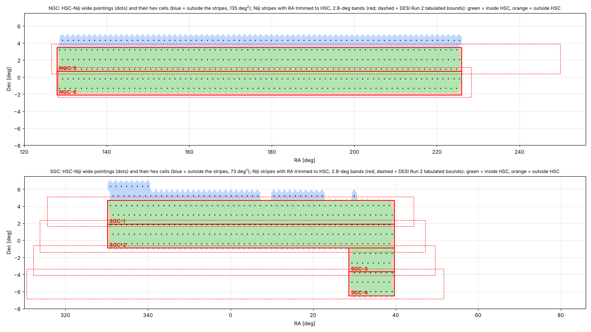
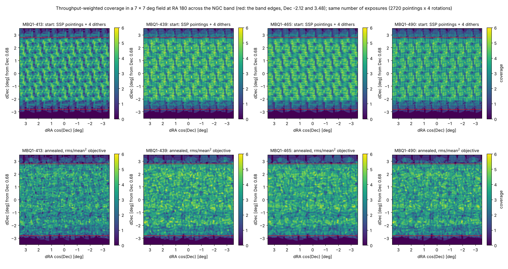
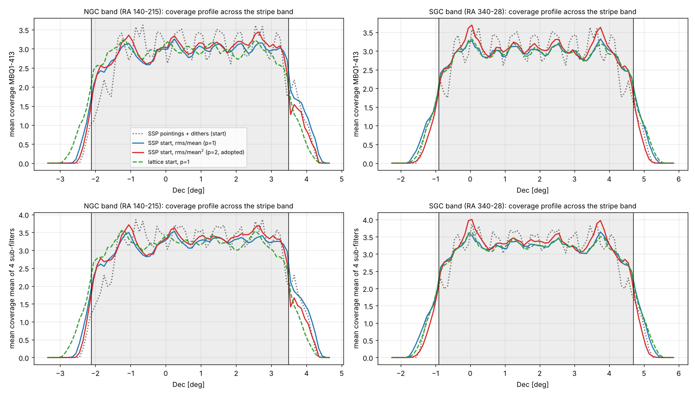
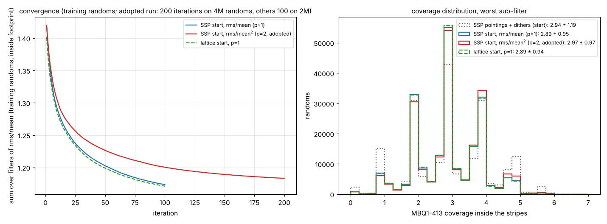

# Annealed HSC + MBQ1 tiling of the DESI Run 2 Niji stripes

*D. Schlegel, 2026-10-08. Code: `skytiling` (`optimize_tiling_maps`, `write_tiling_table`); data in `data/subaru3/`.
Supersedes the tilings of the original HSC-Niji wide footprint (`hsc_mbq1_anneal_summary*.md`).*

**Summary.** The HSC-Niji + VST imaging is restricted to the part of the HSC-SSP Wide footprint that
will be used for DESI Run 2 targeting: 999 deg², 15% less than the 1,171 deg² of Atsushi's 802-pointing
plan. The exposure count falls correspondingly, from 12,832 (802 pointings × 4 dithers × 4 rotations) to
10,880 (680 × 4 × 4), the same 10.9 exposures per deg², and the average coverage is unchanged at
3.0 / 3.4 / 3.4 / 3.3 effective exposures in 413 / 439 / 465 / 490. Annealing the pointing centres and
rotations then spreads that coverage more evenly: rms/mean 0.31 / 0.28 / 0.27 / 0.28 in the interior of the
stripes against 0.35 / 0.29 / 0.30 / 0.29 for the regular dither pattern, with a third less area below 1.5
exposures in the worst filter (4.4% instead of 6.5%).

**Footprint.** The DESI Run 2 imaging plan divides the survey into declination stripes 2.8° apart,
four of which (NGC-5, NGC-6, SGC-1, SGC-2) are to be imaged by HSC-Niji in MBQ1 and by VST in M517.
The HSC footprint adopted here is the unique 2.8° band of each of those stripes with the RA bounds
trimmed to the extent of the existing HSC-SSP Wide imaging — NGC: RA 128.0–226.0, Dec −2.12 to 3.48;
SGC: RA 330.2–39.7, Dec −0.91 to 4.69 — plus the HSC-SSP Wide block south of SGC-2 (RA 28.7–39.7,
Dec −6.51 to −0.91) as the Niji portions of SGC-3 and SGC-4: six rectangles, 999 deg² (Figure 1,
`data/subaru3/niji_stripes_2p8_hsc.csv`). Coverage is required to be uniform inside these rectangles; the
parts of the DESI stripes outside the HSC data are imaged by POLU+IBIS instead.

**Camera model.** The `data/subaru3` throughput maps from Hironao Miyatake's rebuilt dome flats
(8.18′ cross mask, centre CCDs included; `hsc_mbq1_anneal_summary_subaru3.md`). Each pointing is
observed at four instrument rotations 90° apart so that every sub-filter sweeps every quadrant, and the
coverage of a sky point in sub-filter *f* is the sum of throughput over all exposures.

**Setup.** The starting layout is the 680 HSC-SSP Wide pointing centres that fall inside the rectangles
(five rows per 5.6° band in each cap), each with Atsushi's four phase-1 dither offsets: 2720 pointings,
10,880 exposures, 1.47 deg² per centre as in his layout. Simulated annealing then moves every pointing
(drift ≤ 0.75° from its start) and the rotation offset of its 4-PA set. Because the stripes have hard
edges, the objective is no longer the coverage variance (which let earlier solutions push coverage
outside the footprint, where it is not counted) but **Σ_f rms_f / mean_f²** over random points inside
the rectangles: the total coverage of a fixed set of exposures is conserved, so rewarding the mean
inside charges for every exposure spilled outside. The adopted run used 4M randoms and 200 iterations
with the step size shrinking from 0.1° to 0.005°. Two alternatives were run for comparison on 2M
randoms for 100 iterations — the same start with rms/mean (p = 1), and a 1.299° × 1.125° lattice start
fitted to the bands (674 centres, 2696 pointings) with p = 1
(`nersc/anneal_hsc_stripes.sh`; `data/subaru3/anneal/local_stripes/`).

**Result** (6M *independent* randoms; "inside" = all points in the rectangles, "interior" = those more
than 0.75° from a boundary; "spill" = fraction of all coverage landing outside; coverage = effective
number of full-throughput exposures, per sub-filter 413 / 439 / 465 / 490):

| | spill | mean inside | rms/mean inside | rms/mean interior | interior < 1.5 exp. |
|---|---|---|---|---|---|
| start: SSP pointings + dithers | 6.3% | 2.98 / 3.38 / 3.33 / 3.23 | 0.40 / 0.34 / 0.35 / 0.34 | 0.35 / 0.29 / 0.30 / 0.29 | 6.5 / 2.5 / 2.8 / 2.7% |
| annealed, rms/mean (p = 1) | 7.8% | 2.94 / 3.32 / 3.28 / 3.18 | 0.32 / 0.29 / 0.29 / 0.30 | 0.31 / 0.28 / 0.27 / 0.29 | 5.2 / 2.4 / 2.4 / 3.2% |
| **annealed, rms/mean² (adopted)** | **5.4%** | **3.01 / 3.41 / 3.37 / 3.26** | **0.32 / 0.29 / 0.29 / 0.30** | **0.31 / 0.28 / 0.27 / 0.28** | **4.4 / 2.0 / 2.0 / 2.7%** |
| lattice start, p = 1 | 7.1% | 2.93 / 3.32 / 3.28 / 3.17 | 0.32 / 0.29 / 0.29 / 0.30 | 0.31 / 0.28 / 0.27 / 0.29 | 5.2 / 2.4 / 2.4 / 3.1% |

Annealing removes the periodic structure of the dither pattern (Figure 2) and lowers the interior
rms/mean from 0.35 / 0.29 / 0.30 / 0.29 to 0.31 / 0.28 / 0.27 / 0.28, with the fraction of the interior
below 1.5 exposures in the worst filter down from 6.5% to 4.4%. The three anneals reach the same
uniformity, so the starting layout does not matter and the SSP start is kept for its bookkeeping (each
pointing in the table carries the HSC-SSP pointing name it descends from). The objective power does
matter: p = 1 lets 7.8% of the coverage land outside the stripes, more than the start, whereas p = 2
holds it at 5.4%, keeps the mean inside 3% higher, and has the fewest deep holes, at the price of a
slightly steeper roll-off at the band edges. Fewer than 0.3% of interior points in any filter are below
0.5 exposures. Three runs of the adopted case with different randoms and lengths (1M randoms for 151
iterations, 2M for 100, and the adopted 4M for 200) agree to 0.006 in rms/mean and 0.3% in the hole
fraction, so the solution is converged at the level that matters; their tile positions differ by a
median 0.15°, i.e. the optimum is broad.

**Band edges.** Figure 3 shows the coverage as a function of declination across the two bands. With
hard band boundaries the coverage at the edge is 50–80% of the plateau and reaches 90% of it only
0.4–0.8° inside, for every objective: a camera 1.5° across cannot stop at a line, so the choice is between
a roll-off zone inside the band and exposures placed beyond it, and the objective only decides how that
compromise is split. If the 2.8° bands are to be at full depth to their edges, where the POLU+IBIS
stripes take over, the HSC imaging has to extend about 0.4° beyond them — which is what the ±0.35°
padding of the DESI stripe table provides. Annealing over the padded 3.5° bounds instead would add
roughly 125 deg² and 12% more exposures; that is a survey-cost decision rather than a tiling one and is
not made here.

**Rotations and positions.** Rotation offsets have an rms of 16° (44% of pointings turned by more than
10°, 7% by more than 30°); pointings sit a median 0.13° from their starting positions (max 0.75°, the
drift cap). Rounding RA/Dec to 3 decimals and the rotation to 0.1° changes the statistics by ≤ 10⁻³.

*Figure 1. The six rectangles of the HSC-Niji footprint (red; dashed: the DESI Run 2 tabulated stripe
bounds) on the hex cells of the HSC-SSP Wide pointings (green = inside both; the thin orange strip is the
half-covered zig-zag along the bottom of NGC-6).*

*Figure 2. Throughput-weighted coverage per sub-filter in a 7° × 7° field at RA 180° across the NGC band
(red lines: the band edges at Dec −2.12 and 3.48), for the starting layout (top) and the adopted annealed
tiling (bottom), same colour scale and the same number of exposures.*

*Figure 3. Mean coverage as a function of declination across the NGC band (left, RA 140–215) and the SGC
band (right, RA 340–28), in MBQ1-413 (top) and averaged over the four sub-filters (bottom), for the start
and the three anneals; the shaded region is the band.*

*Figure 4. Convergence of the anneals on their training randoms, and the distribution of MBQ1-413
coverage inside the stripes on independent randoms.*

**Files.** The adopted table is `data/subaru3/anneal/local_stripes/hsc_mbq1_tiling_stripes_final.{csv,fits}`,
2720 rows of `tileid, pointing, dither, ra, dec, rot, ra_init, dec_init`: each row is one pointing to be
observed at rotation offsets `rot`, `rot+90`, `rot+180`, `rot+270`; `pointing` is the HSC-SSP Wide
pointing name (`W_010001`, …) and `dither` Atsushi's phase-1 dither index (1–4 for offsets
(12.2, 19.5), (−19.5, 12.2), (−12.2, −19.5), (19.5, −12.2) arcmin) that the tile descends from, and
`ra_init, dec_init` is that starting position, i.e. the tile centre of his table, so every row can be
cross-referenced to his tiling; the four dithers of a pointing are consecutive rows. RA/Dec are given
to 1e-3°, `rot` to 0.1°. The same directory holds the start and final checkpoints and log of the adopted
run (`final_p2_*`), the comparison runs, and the evaluation scripts. The mapping of `rot` onto
`INSROT_PA` still has to be calibrated against the instrument.
