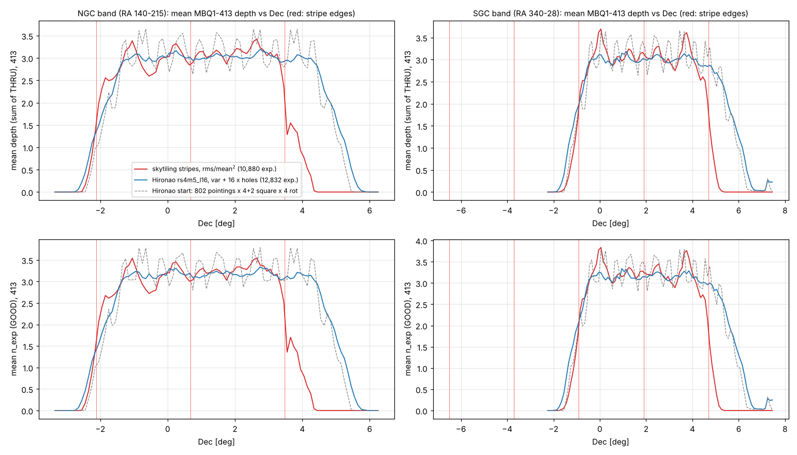
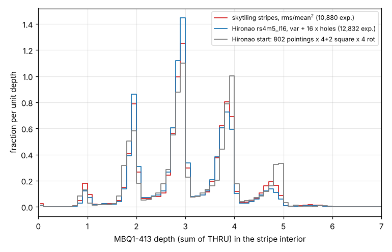
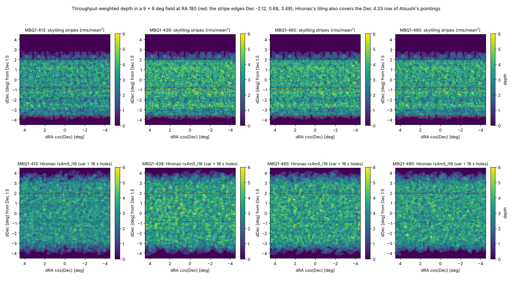

# Hironao's annealed tiling (rs4m5_l16) compared with the skytiling stripes tiling

*D. Schlegel, 2026-10-09. Hironao's solution: `hsc-niji-survey/wide-observing-strategy`,
`wide_dithering/anneal_results/holes_rs4m5_l16_tiles_0300.fits` and
`plan_ADOPTED_rs4m5_l16_iter300/master_pointing_list_rs4m5_l16_iter300.csv` (commit 6bdb591);
ours: `data/subaru3/anneal/local_stripes/hsc_mbq1_tiling_stripes_final.csv`. Evaluation code and
figures in `data/subaru3/anneal/compare_hironao/`.*

**Summary.** Hironao's adopted tiling is a hole-penalised annealing of Atsushi's full 802-pointing
plan (12,832 exposures over 1,171 deg²), built with a modified copy of `skytiling` in which every
exposure is a free tile (its own position *and* rotation) and the objective is the sum of the coverage
variances plus 16 × the fraction of interior points seen at most once in any sub-filter. Inside our
stripes it is a little more uniform than our solution — rms/mean summed over the four filters 1.10
against 1.15, with 8.2% instead of 8.8% of the interior seen ≤ 1 time in some filter — at the same
average depth (3.0 / 3.4 / 3.4 / 3.3). The gain comes from the per-exposure rotation freedom, not
from the hole term: his un-penalised rot-each run (A) has the same rms/mean but more holes
(11.3%), and his regular start has the fewest holes of all (7.2%) but the worst rms/mean (1.21).
The real difference between the two tilings is the footprint: his covers the whole HSC-SSP Wide
area including the Dec 4.3–6.4 rows that are outside the DESI Run 2 stripes, so 22% of his exposure
coverage falls outside our rectangles (10,412 of his 12,832 exposures are centred inside them)
versus 5.5% of ours; ours leaves nothing above Dec 3.48 / 4.69 and uses 1,950 fewer exposures.

## What Hironao did

Starting from `tools/skytiling` (a copy of this repository), he

- optimised the phase-1 dither pattern on the new throughput map (square, R = 22.5′, θ = 30°;
  his README §17), and laid it on Atsushi's 802 pointings with rotations 0/90/180/270 → 12,832
  tiles with `--rotations 0`, i.e. each exposure is its own tile (`make_rot_each_tiles.py`);
- annealed with our settings (4M randoms, 300 iterations, max drift 0.75°, 4 moves per tile,
  rotation step 10°, step 0.1° × 0.99) on the hex-cell footprint of the 802 pointings (`Footprint`,
  radius 0.75°), with `optimize_tiling_holes.py`: objective Σ_f Var(depth_f) + λ × (fraction of the
  interior with n_exp ≤ 1 in ≥ 1 filter), n_exp from the GOOD maps, λ = 16, and the randoms
  redrawn every 5 iterations (`--resample-every 5`, because the hole fraction over-fits a fixed set
  of randoms: 5.3% on the run's own points vs 7.5% on fresh ones);
- evaluated everything on an independent 0.2′ grid in RA 175–185, Dec −1.37..2.73 (our NGC
  interior), including our stripes table (`eval_reports/eval_schlegel_table.pdf`): sum of rms/mean
  1.154 for ours, 1.086 for rs4m5_l16, union hole fraction 9.2% vs 7.2% — consistent with the
  numbers below;
- adopted rs4m5_l16 at iteration 300 for the S26B October run (601 exposures planned over Oct 8–13
  in XMM / SHERA / DEEP2-3), with shot names `W-MBQ1-<pointing_id>-d<dither>-r<rot>`.

Geometry of his solution relative to his start: median displacement 0.14° (90% < 0.30°, max 0.74°
at the drift limit), rotation changes rms 12° (40% > 10°, 3% > 30°), rotations now deviate from
multiples of 90° by rms 12° (12% by more than 20°), and the four "rotations" of one dither have
drifted apart by a median 0.27° (max 0.9°). The 0/90/180/270 structure is therefore only loosely
preserved; the instrument-rotator limits are handled in his exposure planner instead.

## Evaluation on common randoms

2M uniform randoms over the union of the two footprints + 1.2° (`eval_compare.py`), depth = sum of
THRU, n_exp = rounded sum of GOOD, both from `data/subaru3/hsc_mbq1_throughput.fits`
(= his `hsc_mbq1_throughput_8p18.fits`). "Stripe interior" is 0.75° inside the six rectangles,
"hex interior" is `Footprint.interior` of the 802 hex cells. Means and rms/mean are per filter
413 / 439 / 465 / 490; "n ≤ 1 union" is the area seen at most once in at least one filter.

| tiling | exposures (in stripes) | spill outside stripes | stripe interior: mean | rms/mean | Σ rms/mean | n ≤ 1 union | n = 0 union |
|---|---|---|---|---|---|---|---|
| ours, stripes, rms/mean² (final_p2) | 10,880 (10,572) | 5.5% | 3.07 / 3.52 / 3.46 / 3.35 | 0.310 / 0.278 / 0.274 / 0.286 | **1.148** | 8.8% | 0.62% |
| Hironao rs4m5_l16 (adopted) | 12,832 (10,412) | 22% | 3.02 / 3.42 / 3.37 / 3.28 | 0.289 / 0.272 / 0.265 / 0.273 | **1.098** | 8.2% | 0.35% |
| Hironao A (rot-each, no hole term) | 12,832 (10,189) | 24% | 2.92 / 3.32 / 3.27 / 3.17 | 0.301 / 0.272 / 0.266 / 0.277 | 1.117 | 11.3% | 0.59% |
| Hironao start (802 × square × 4 rot) | 12,832 (10,580) | 20% | 3.16 / 3.61 / 3.55 / 3.44 | 0.316 / 0.294 / 0.285 / 0.314 | 1.208 | 7.2% | 0.31% |

Over his own footprint (hex interior) rs4m5_l16 gives Σ rms/mean 1.107, n ≤ 1 union 8.8%; ours is
not defined there (the Dec 4.3 row is empty: 21% of the hex interior is below 1.5 exposures).

Per rectangle (whole rectangle, edges included):

| rectangle | ours: Σ rms/mean, n ≤ 1 union | Hironao: Σ rms/mean, n ≤ 1 union |
|---|---|---|
| NGC-5 | 1.126, 8.4% | 1.118, 8.5% |
| NGC-6 | 1.287, 14.4% | 1.327, 18.9% |
| SGC-1 | 1.229, 11.3% | 1.151, 10.2% |
| SGC-2 | 1.198, 10.3% | 1.174, 11.7% |
| SGC-3 | 1.202, 11.0% | 1.249, 13.5% |
| SGC-4 | 1.290, 13.7% | 1.346, 18.3% |

The southern rectangles (NGC-6, SGC-4, SGC-3) are worse in his tiling because their lower edges
(Dec −2.12, −6.51) lie 0.1–0.2° below the edge of Atsushi's hex cells, which his footprint does not
cover; the interior numbers above exclude the edges.

*Figure 1. Mean 413 depth (top) and exposure count (bottom) against Dec across the NGC band
(RA 140–215) and the SGC band (RA 340–28). Red: ours; blue: Hironao's rs4m5_l16; dashed grey: his
regular start. Red vertical lines are the stripe edges. His tiling continues to Dec ≈ 5.5 (NGC) and
6.5 (SGC); inside the bands his profile is flatter (the ±0.2 undulation in ours is the residual of
the SSP pointing rows).*

*Figure 2. Distribution of 413 depth in the stripe interior. His solution has more area at
exactly 2 and 3 exposures and less in the wings at 1 and at 4–5.*

*Figure 3. Depth maps in a 9 × 9° field at RA 180: ours (top) and his (bottom).*

## Where the difference comes from

- **Per-exposure rotations.** Our tiles are 2,720 pointings each observed at four rotations 90°
  apart around a common centre; his 12,832 exposures are independent. That is 4× more degrees of
  freedom in the same exposure budget, and it lowers Σ rms/mean by ~4% (1.148 → 1.10–1.12 in both
  his runs with and without the hole term). It costs the clean rotate-and-repeat structure: an
  exposure's three "partners" are no longer at the same centre, so the quadrant-sweeping argument
  for the sub-filter layout holds only statistically.
- **The hole term** does what the rms/mean² exponent does for us at the edge, but in the interior:
  with λ = 16 the n ≤ 1 area drops from 11.3% (run A) to 8.2% at essentially the same rms/mean.
  Our `cv` objective with p = 2 has no explicit hole term; our 8.8% is between his two. A hole
  penalty would be easy to add to `optimize_tiling_maps` (his `_worker_holes` is a drop-in patch).
- **Resampled randoms.** He found that a fixed 4M random set over-fits the hole statistic by ~2
  points; the variance objective is far less sensitive (our three independent runs agree to 0.006 in
  rms/mean), but the hole fractions quoted in our logs are also measured on the annealing randoms
  and should be read as slightly optimistic.
- **Footprint.** The rest is the footprint decision, not the optimiser: his tiling spends 2,420
  exposures (19%) on the Dec 4.3–6.4 rows and the hex-cell edges outside the DESI stripes, and its
  coverage inside the stripes is helped at the top edge by those rows (Figure 1). Our tiling is
  the same density (10.9 exposures per deg²) on 999 deg² only.

**Cross-reference.** His `pointing_id` (`010001` …) is Atsushi's pointing number, the same key as
our `pname` (`W_010001`); `dither_id` 0–3 is our `dither`; his `rotation_id` 0–3 corresponds to
our `rot` 0/90/180/270 only at the start (his final rotations are free).

**Bottom line.** For the stripes we want, the two solutions have the same depth and nearly the
same uniformity; his is ~4% better in rms/mean and ~0.6 points better in holes thanks to
per-exposure rotations and the hole penalty, and it is what is being observed in October. If the
footprint is restricted to the DESI stripes later, the natural step is to run his rot-each +
hole-penalty objective on the stripe footprint with the `cv` p = 2 edge treatment, which should
combine both gains and save the ~2,400 exposures north of the stripes.
